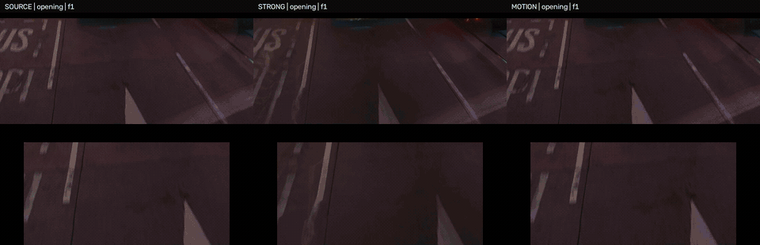

# NightFrame灯光闪烁修复

**阶段性实验废案 / Experimental archive**

一个保留新拟物界面的 Windows 本地视频处理 App，提供灯光去闪烁与画质修复。这是一次夜景 LED 频闪修复实验的阶段性公开存档，暂不继续主动开发，也没有同时实现“彻底去闪烁、无虚影、所有纹理清晰”的目标。

## 去闪烁：两档，两个取舍

| 模式 | 目标与实际表现 | 代价 |
| --- | --- | --- |
| **强力** | 优先压制电子屏、招牌和夜景灯光频闪。在本项目展示素材上，作者的主观评价是可以获得“完美去频闪”的观感。 | 9 帧运动补偿融合及插帧会影响运动画面，可能出现虚影、涂抹与变形。 |
| **运动保护** | 保留每个原始 30 fps 时刻，结合 SEA-RAFT 运动可靠性、局部亮度校正与电子屏缺失内容恢复，减少运动损伤。 | 仍可能残留频闪；遮挡、误判或局部对齐失败时仍可能失真。 |

作者觉得强力档的使用效果类似 Premiere Pro 中 [RE:Vision Effects DE:Flicker](https://revisionfx.com/products/deflicker/premiere-pro/) 的强去闪烁处理：频闪压得越狠，运动虚影的代价越明显。在作者自己的机器和素材上，独立 App 工作流的主观使用体验更稳定、较少遇到崩溃；**这不是对两者崩溃率的系统评测**。本项目与该插件没有隶属或授权关系，也没有使用其代码。

## 对照视频

左侧 **SOURCE：原片**，中间 **STRONG：强力**，右侧 **MOTION：运动保护**。下半屏是对应局部放大。包含道路、公交电子屏、背景灯光和快速运动桥梁四段，共 8.3 秒。

https://github.com/user-attachments/assets/5335d3e5-3de6-41d7-9d73-1aef4359098c

[打开原始对照视频](https://github.com/LLLimit/NightFrame/releases/download/v1.1.1-experimental/NightFrame_comparison_original.mp4)

<details>
<summary>GIF 预览（静音）</summary>



</details>

演示素材只代表这段视频上的结果，不是所有夜景视频的效果保证。

## 功能

- 去闪烁仅提供 **强力 / 运动保护** 两档。
- 画质修复可选 **SeedVR2 3B / 7B Sharp**，直接处理当前所选视频。
- **设置 → 默认导出位置**：浏览选择文件夹，或粘贴完整路径，保存后重启仍然生效。
- 2 秒试处理、预览起点、保留音轨、进度日志、停止任务、最近任务与成片播放。
- 去闪烁输出最高 1080p / 30 fps；画质修复提供 1080p / 4K，统一输出 30 fps。
- 保留固定黑边，结果旁写入处理记录；输出完成后完整解码检查，原视频不覆盖。

画质修复不能可靠消除已经融合进成片的重影。SeedVR2 会重建纹理，字形和细节可能改变。4K 选项已实现，但本阶段实际导出验证集中在 1080p。

## Windows 使用

1. 从 [Releases](https://github.com/LLLimit/NightFrame/releases) 下载 Windows x64 ZIP，完整解压到空间充足的目录，保留所有文件。
2. 准备 **Python 3.12 x64、FFmpeg（含 NVENC）、NVIDIA 显卡及兼容驱动、Microsoft Edge WebView2**。强力档还会调用 Vulkan RIFE。
3. 在解压目录运行 PowerShell：

   ```powershell
   powershell -ExecutionPolicy Bypass -File .\setup_windows.ps1
   ```

   默认安装去闪烁所需模型。若同时使用画质修复：

   ```powershell
   powershell -ExecutionPolicy Bypass -File .\setup_windows.ps1 -Models all
   ```

4. 运行 `start.cmd` 或 `NightFrame.exe`。源代码版本也可运行 `start.cmd`，它会使用本项目的 Python 环境启动界面。
5. 选择原视频，先试处理两秒；满意后再处理整段。需要画质修复时，再选择去闪烁后的成片。

模型、环境、缓存和偏好保存在项目目录。ZIP **不包含多 GB 的模型或 CUDA PyTorch**，首次设置需要联网下载。设置脚本固定上游版本并校验权重 SHA256。它不会调用开发者电脑上的其他项目环境。

实测机器为 RTX 5070 Ti Laptop / 12 GB 显存、Windows 11。当前支持 SDR；HDR / HLG 需要先转换。其他显卡与全新机器上的完整环境安装尚未逐一验证。

## 项目结构与构建

```text
desktop/          新拟物界面、设置、任务调度和 GPU worker
src_v03/          强力去闪烁及 Flickerformer 适配
src_v06/          运动保护流程
scripts/          固定版本的上游代码、模型下载与校验
models.lock.json  来源、版本与权重哈希
setup_windows.ps1 本项目内的 GPU 环境设置
build_windows.ps1 Windows 界面构建
```

源码构建：

```powershell
powershell -ExecutionPolicy Bypass -File .\build_windows.ps1
```

首次构建后的 `dist\NightFrame` 也需要运行其目录中的设置脚本。

## 验证范围

- Windows 原生界面启动、两档切换与设置保存/取消。
- 默认导出位置的重启记忆及导出路径传递。
- 新版 EXE 的强力、运动保护实际短片导出；检查帧数、30 fps、音轨与完整解码。
- 运动保护另有四类镜头、249 帧的实验对照。
- 既有 SeedVR2 3B / 7B Sharp 短片导出验证；这次保留其实现。

没有干净真值视频，局部亮度代理指标不能当作主观评分或“去闪烁成功率”。

## 来源、许可与署名

界面参照 [新拟物派 Neumorphism](https://luckymaomi.github.io/ui/styles/neumorphism/)。

- [Flickerformer](https://github.com/qulishen/Flickerformer)：频闪恢复模型。
- [SEA-RAFT](https://github.com/princeton-vl/SEA-RAFT)：运动与不确定性估计，BSD-3-Clause。
- [RIFE ncnn Vulkan](https://github.com/nihui/rife-ncnn-vulkan)：强力模式中的帧插值。
- [SeedVR2](https://github.com/ByteDance-Seed/SeedVR) 与 [NumZ 推理实现](https://github.com/numz/ComfyUI-SeedVR2_VideoUpscaler)：画质修复，相关代码按上游许可使用。
- 思路参考 [Selective LED Flicker](https://doi.org/10.1109/ICCE-Berlin.2018.8576189) 与 [FlickerFix](https://www.kibme.org/resources/journal/20251222144147743.pdf)。工程扩展不等于论文原版复现。

原创 App 与工程适配代码见 [MIT License](LICENSE)。第三方代码及权重不随源码仓库重新授权，按各自上游条款下载使用，详见 [THIRD_PARTY_NOTICES.md](THIRD_PARTY_NOTICES.md)。

项目维护与发布：[LLLimit](https://github.com/LLLimit)。
